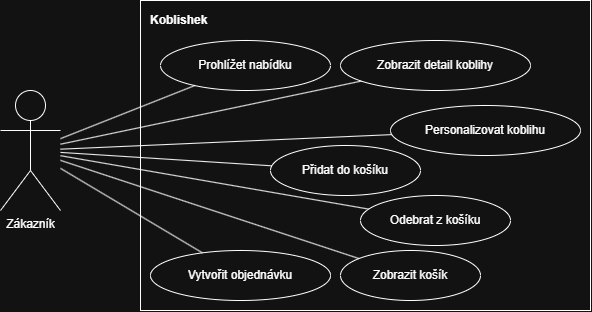
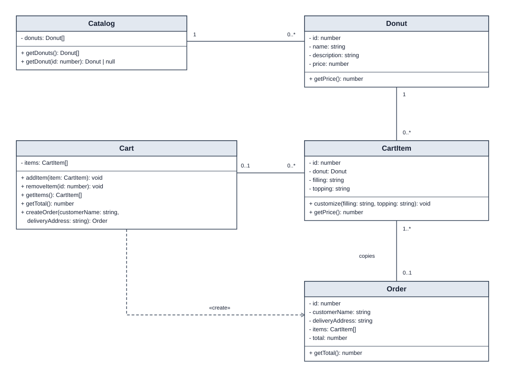
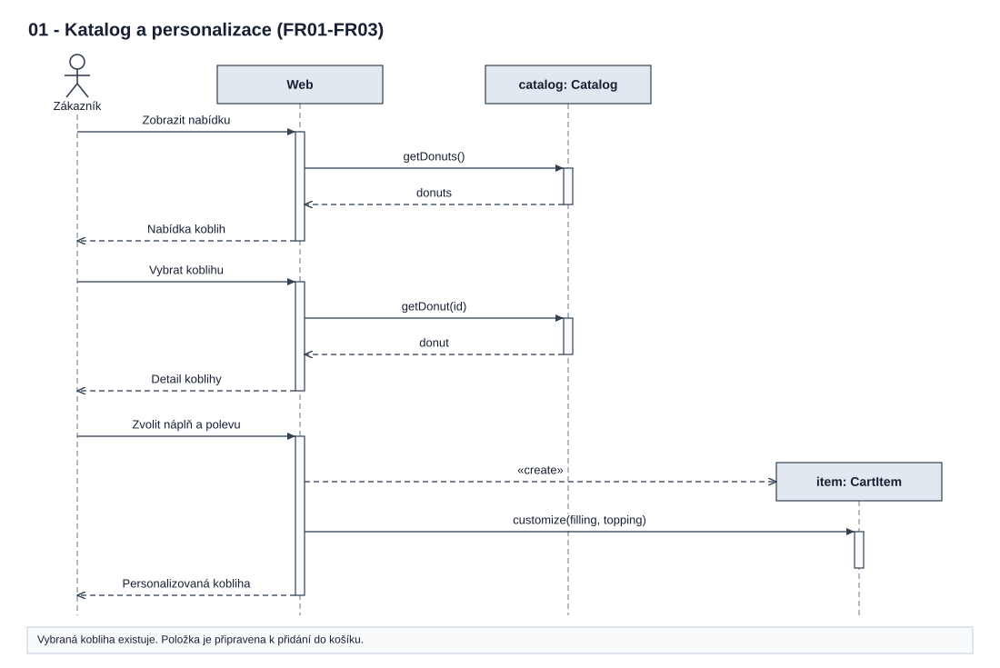
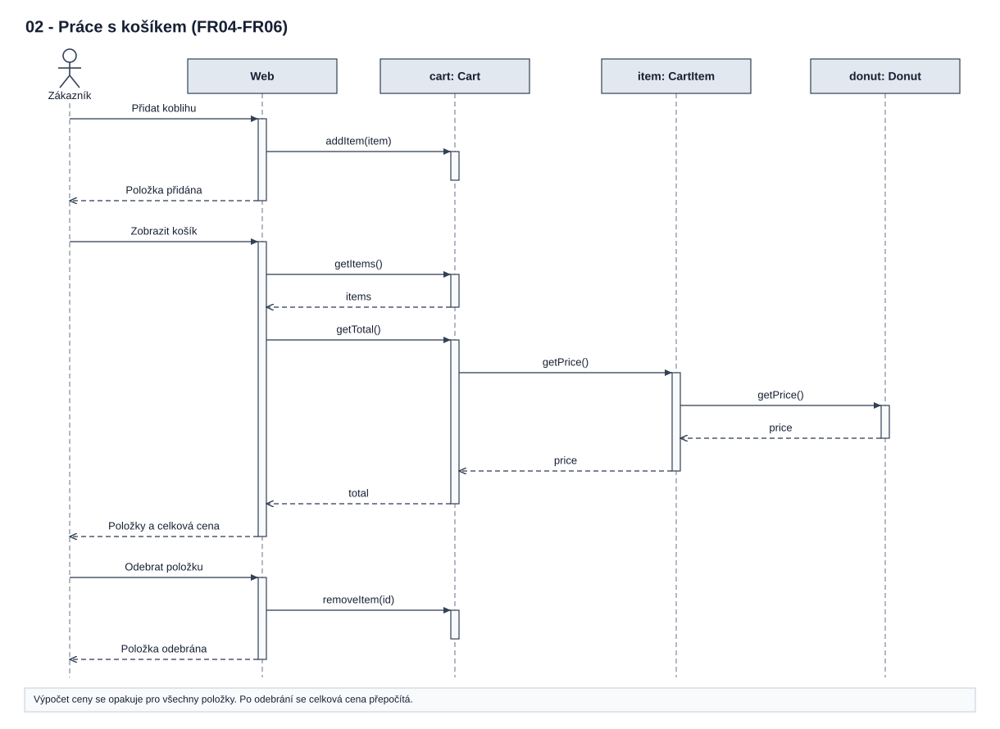
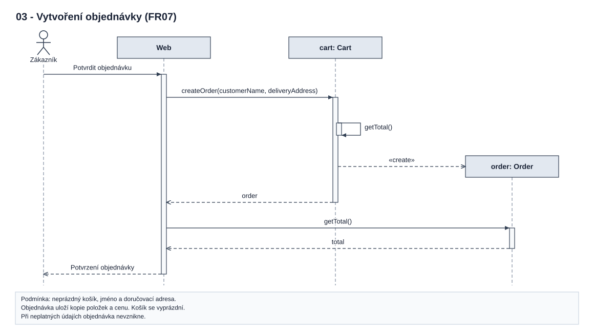

# Koblishek

Jednoduchý fiktivní e-shop na personalizované koblihy.

## Cíl projektu

Návrh a implementace jednoduchého e-shopu na kterém budu demonstrovat základní principy softwarového inženýrství.

## Tech stack

- HTML
- CSS
- JavaScript
- Git
- GitHub
- UML (Draw.io)

## Metodika vývoje

- Model: iterativní vývoj (Cycle)
- Přístup: zjednodušený Scrum
- Evidence úkolů: Kanban (To Do, In Progress, Done)
- Průběh iterace: plánování, návrh, implementace, testování, vyhodnocení

## Dokumentace

- [Requirements](docs/requirements.md)
- [Classes](docs/classes.md)

## UML

### Use Case diagram

### Class diagram

[Draw.io source](docs/uml/class-diagram.drawio)

### Sequence diagrams

[Draw.io source](docs/uml/sequence-diagrams.drawio)

#### Katalog a personalizace (FR01–FR03)

#### Práce s košíkem (FR04–FR06)

#### Vytvoření objednávky (FR07)

